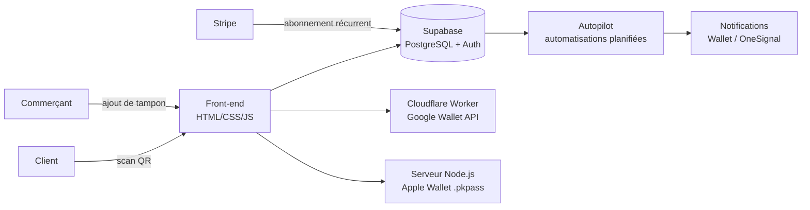

# PassFlow – étude de cas

**Plateforme SaaS de cartes de fidélité digitales pour Apple Wallet et Google Wallet, conçue, développée et vendue de bout en bout pour des commerces de Suisse romande.**

> Le code source de PassFlow est propriétaire. Ce dépôt présente le problème, l'architecture, les choix techniques et les résultats.

🔗 [passflow.ch](https://passflow.ch)

---

## Le problème

Les petits commerces (restauration, barbershops, salons) perdent une partie de leurs clients après la première visite. Les cartes à tampons en carton se perdent, ne génèrent aucune donnée, et le commerçant n'a aucun moyen de recontacter ses clients.

## La solution

Une carte de fidélité ajoutée en un scan dans le Wallet du téléphone, sans application à installer :

- le client scanne un QR code en caisse et sa carte apparaît dans Apple Wallet ou Google Wallet ;
- le commerçant ajoute un tampon depuis son interface ;
- la carte se met à jour en temps réel et peut recevoir des notifications.

### Module « Autopilot » : l'automatisation au service de la relation client

| Déclencheur | Action automatique |
|---|---|
| Visite enregistrée | Demande d'avis Google envoyée 1 h plus tard |
| Client inactif depuis 30 jours | Notification personnalisée pour le faire revenir |
| Événement local (match, fête) | Campagne de notification ciblée |

## Architecture

| Brique | Rôle |
|---|---|
| HTML / CSS / JavaScript | Interfaces client et commerçant |
| Supabase | Base de données, authentification, logique serveur |
| Cloudflare Workers | Génération et mise à jour des cartes Google Wallet |
| Node.js | Signature des passes Apple Wallet |
| OneSignal | Notifications push |
| Stripe | Abonnements mensuels avec essai gratuit |

## Itérer à partir du terrain

Le produit a évolué à partir des retours des commerçants, pas d'un cahier des charges figé :

- **Première version** en HTML/JS avec stockage local, pour valider l'usage en caisse en quelques jours.
- **Migration vers Supabase** dès que plusieurs commerces ont dû partager une vraie base.
- **Protection des données** : un commerçant craignait que ses clients refusent de donner leur téléphone ou leur email. Ces champs sont devenus optionnels, remplacés par un numéro client unique affiché sur la carte.
- **Formation et supports** : guides de notifications, affiche en caisse avec QR code, accompagnement à la prise en main pour chaque commerçant.

## Résultats

- **400+ clients inscrits** sur la carte du premier commerce partenaire, quelques mois après le lancement
- **Taux de retour de 50 %** chez le premier commerce partenaire
- Plusieurs commerces genevois équipés (restauration, barbershop)
- Facturation récurrente automatisée en CHF

## Mon rôle

Co-fondateur. J'ai conçu et développé la plateforme (front-end et back-end), et je m'occupe de la vente, de l'installation chez les commerçants, de leur formation et du support.

---

Adenay Tesfai · Genève · [alpineflow.ch](https://alpineflow.ch)
